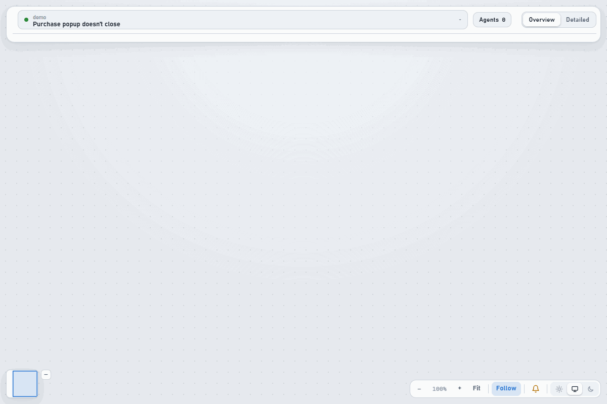
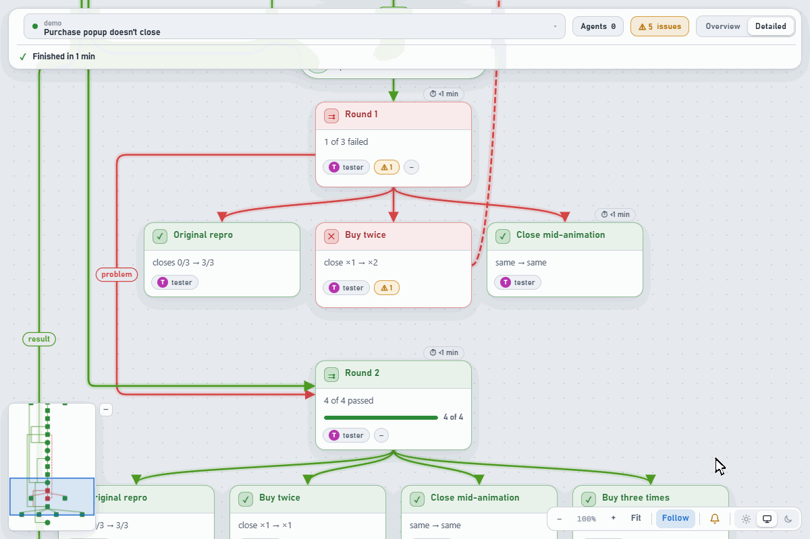

<div align="center">


<br>

An agent for Unity that reproduces the bug in Play Mode, weighs competing fixes, lets you pick one,<br>
then re-tests in the same setup, before → after. You watch every decision live.

[Install](#install) · [How it works](#how-it-works) · [Agent Trace](#-agent-trace-watch-it-think)

</div>

<br>

## Why

| Agents usually | unity-dev |
| --- | --- |
| ❌ Guess the cause from the code | ✅ Reproduce it in Play Mode: a driver script plays the scenario, logs record what happens |
| ❌ Patch the first idea that comes to mind | ✅ Compare competing fixes: a critic tries to break each, a judge scores them. **You pick** |
| ❌ Say "fixed" when it compiles | ✅ "Fixed" only after QA in the game: same setup, **before → after** |
| ❌ Tweak a shared prefab or base class "while here" | ✅ Anything that changes behavior outside your scenario is your call |
| ❌ Work as a black box | ✅ A live tree of every step, the rule behind it and the evidence |
| ❌ Answer with a wall of text | ✅ The answer in the first line, then a picture |

## How it works

Every task that touches the project runs the same stages: implement, debug, optimize, review or merge.


- **Sub-agents in parallel.** One per hypothesis, one per R&D branch, a critic for each branch, a reviewer and a tester who didn't write the change.
- **Its own test scene from your prefabs.** The part under check stays original; the scene stays in the project for the next round.
- **Works through your Editor.** Uses the project's Unity MCP bridge, or offers to install [MCP for Unity](https://github.com/CoplayDev/unity-mcp). One Unity per project, and it won't close an Editor you have open.
- **Remembers the project.** A private `.ai-profile/` (never committed): stack, patterns, fragile spots, how to bring objects into a testable state.

## 🌳 Agent Trace: watch it think

**Live.** The task grows stage by stage while the agents work.

<picture>
  <source media="(prefers-color-scheme: dark)" srcset="docs/media/trace-live-dark.gif">
  
</picture>

<sub>Demo trace, replayed: a purchase popup that doesn't close. The first fix fails Play Mode QA, round 2 passes.</sub>

**Ask "why" on any step.**

<picture>
  <source media="(prefers-color-scheme: dark)" srcset="docs/media/trace-why-dark.gif">
  
</picture>

- **Hover** a step: the rule that decided it. **Click**: the evidence, down to the exact log or code lines.
- **⚠ flags** what's missing: a rule the skill expects and nobody cited, e.g. an R&D branch without a critic.
- **Local only.** Opens with every Codex or Claude Code session. Python standard library, nothing leaves your machine.

## Answers you get in 5 seconds

One answer format, built for ADHD and for anyone who wants results instead of articles:

- **First line = the answer.** Yes / no / the cause / the number. Then at most 5 bullets.
- **Show, don't tell.** Diagrams, screenshots, before / after, tables with ✅ ⚠️ ❌.
- **Fixed blocks:** Done · Your action needed · Not verified. Nothing hidden in prose.

## Install

Two plugins, built for each agent app: `ai-skills` (the skills) and `ai-graph` (Agent Trace, optional: the live graph of the work, for any agent and any skill). The commands below install both. Both need Python 3; the Unity skill, a Unity project.

```bash
git clone https://github.com/Watcher3056/ai-skills
cd ai-skills
```

### Codex

Needs the [Codex](https://github.com/openai/codex) app or CLI.

```bash
codex plugin marketplace add "$PWD"
python tools/build_plugin.py --install
```

Restart Codex, run `/hooks` and trust the plugins' hooks. Only one of them: add `--plugin ai-skills` (or `ai-graph`). Then, in your Unity project:

```text
$unity-dev the purchase popup doesn't close after the second buy
```

### Claude Code

Needs [Claude Code](https://code.claude.com) (app or CLI); on Windows, Git Bash, since the plugins' hooks run in bash.

```bash
python tools/build_plugin.py --host claude --install
```

It adds the repo's marketplace and installs `ai-skills@ai-skills` and `ai-graph@ai-skills`. Restart Claude Code (or run `/reload-plugins`). Then, in your Unity project:

```text
/ai-skills:unity-dev the purchase popup doesn't close after the second buy
```

The skill's roles come with the plugin as sub-agents (`ai-skills:unity-dev-tester`, etc.).

## Also in the box: 🧭 everyday-assistant

The same plugin carries a skill for everything that isn't code: research, shopping, emails and forms, tax, legal and health questions, PC trouble.

- **Checks claims, yours too.** Real reviews and forums, not only official pages. A guess is labelled as a guess.
- **Does the work up to the irreversible step:** the cart, the form, the draft. Then waits for your "send".
- **You always do:** payment, CAPTCHA, passwords, signatures. It tells you exactly where.

<details>
<summary><b>Repo map</b></summary>

```text
skills/
  unity-dev/             SKILL.md + references for each mode
  everyday-assistant/    SKILL.md + references for each topic
hosts/                   each app's own words for the skills (tools, configs, limits)
trace-viewer/            the graph plugin: the viewer, its hooks, its MCP server, a replayable demo
skills-plugin/           the skills plugin's own hooks (each role's files, the tester's core rules, briefs)
tools/build_plugin.py    builds the plugins for an app: dist/ai-skills and dist/ai-graph (Codex), dist/claude/…
.agents/, .claude-plugin/  the marketplaces Codex and Claude Code install from
docs/                    rule watch, benchmark plan, ideas
unity-development-plugin/  the earlier package, kept for reference
```

Viewer details: [trace-viewer/README.md](trace-viewer/README.md).

</details>

<details>
<summary><b>How the rules are made</b></summary>

- **From real work.** Rules come from real chat history and real failures, then get generalized: no project names, examples from varied domains.
- **Directions, not dogma.** Strict wording only for safety, correctness and your explicit decisions. Everything else is a direction plus challenge questions.
- **Tested before trusted.** Each rule change runs on benchmark cases with a blind judge and stays in [docs/rule-watch.md](docs/rule-watch.md) until runs confirm it.

Rules for contributors: [AGENTS.md](AGENTS.md).

</details>
