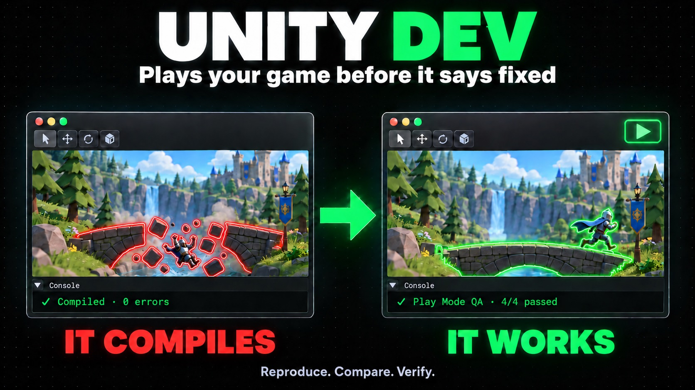
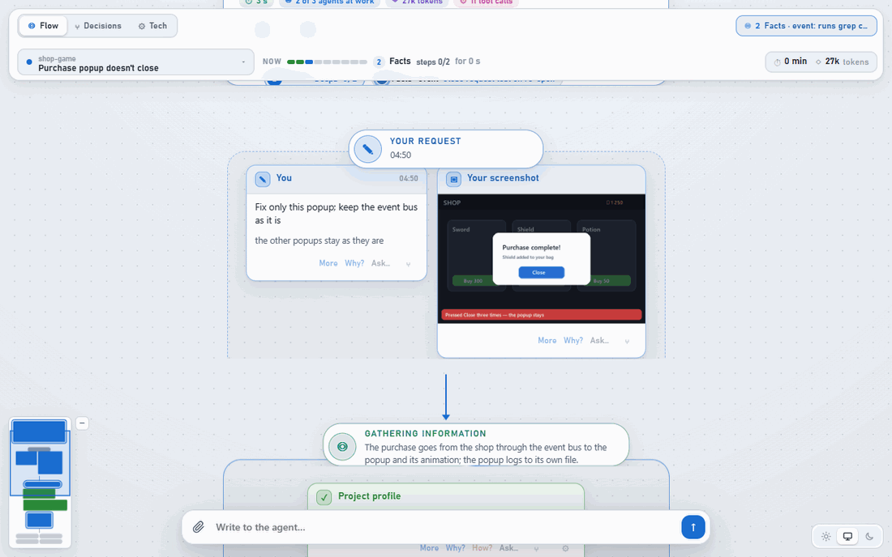
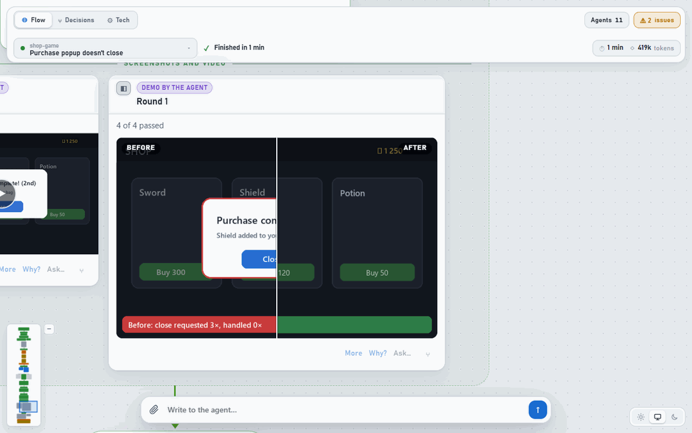

<div align="center">



<br>

An agent for Unity that reproduces the bug in Play Mode, weighs competing fixes, lets you pick one,<br>
then re-tests in the same setup, before → after. You follow it in **Flow**, not in a wall of chat.

[At a glance](#at-a-glance) · [How it works](#how-it-works) · [Flow](#-flow-the-task-not-the-chat) · [Install](#install) · [FAQ](#faq)

</div>

<br>


## Why

| Agents usually | unity-dev |
| --- | --- |
| ❌ Guess the cause from the code | ✅ Reproduce it in Play Mode: a driver script plays the scenario, logs record what happens |
| ❌ Patch the first idea that comes to mind | ✅ Compare competing fixes: a critic tries to break each, a judge scores them. **You pick** |
| ❌ Say "fixed" when it compiles | ✅ "Fixed" only after QA in the game: same setup, **before → after** |
| ❌ Tweak a shared prefab or base class "while here" | ✅ Anything that changes behavior outside your scenario is your call |
| ❌ Bury the work in a long chat | ✅ **Flow:** findings, options, your choice and the checks as cards you scan in seconds |
| ❌ Answer with logs, diffs and a wall of text | ✅ **No fluff:** the answer first, in the game's words, then a picture as proof |

## At a glance

Short animations of what unity-dev does. The real interface is in [Flow](#-flow-the-task-not-the-chat) below.


## How it works

Every task that touches the project runs the same stages: implement, debug, optimize, review or merge.


- **Sub-agents in parallel.** One per hypothesis, one per R&D branch, a critic for each branch, a reviewer and a tester who didn't write the change.
- **Its own test scene from your prefabs.** The part under check stays original; the scene stays in the project for the next round.
- **Works through your Editor.** Uses the project's Unity MCP bridge, or offers to install [MCP for Unity](https://github.com/CoplayDev/unity-mcp). One Unity per project, and it won't close an Editor you have open.
- **You pick the depth.** **Fast:** no Play Mode round, the report lists what to check in the game. **Normal:** reproduce and QA in Play Mode. **Deep:** measured before → after across every scenario.
- **Remembers the project.** A private `.ai-profile/` (never committed): stack, patterns, fragile spots, how to bring objects into a testable state.

## ◎ Flow: the task, not the chat

A chat with an agent grows into a wall of text you scroll back through. **Flow** lays the same task out as cards: what was found, the fixes side by side, the question that waits for you, what was checked.

<picture>
  <source media="(prefers-color-scheme: dark)" srcset="docs/media/unity-flow-dark.gif">
  
</picture>

- **Decide where the choice is.** The question stands on the decision's card, the options' pros and cons right above it. One click answers.
- **Read what the player sees.** Cards speak the game's words: "the popup stays open after the second purchase", not class names.
- **See where the work is.** Each agent shows on the step it works on; the bar says what runs now and what waits for you.

**Proof, not prose.** The checks come with their evidence: drag across the before → after, open a step's details beside the canvas.

<picture>
  <source media="(prefers-color-scheme: dark)" srcset="docs/media/unity-proof-dark.gif">
  
</picture>

- **More · Why? · How?** on every card: the step's plan, results, rules and evidence open beside it, the place on the canvas kept.
- **Two more views when you need them.** **Decisions:** the reasoning graph, every step with its rule and evidence. **Tech:** what each agent did, with time and tokens.
- **Local.** The viewer runs on your machine and opens with every Codex or Claude Code session. It is [FlowAI Graph](https://github.com/Watcher3056/flow-ai-graph), built into this plugin.

<sub>The animations at the top are illustrations drawn for this page. The recordings in this section are the actual viewer; the popup scenario is a scripted demo replay with illustrative evidence, not a new Unity test run.</sub>

## Answers you get in 5 seconds

One answer format, built for ADHD and for anyone who wants results instead of articles:

- **First line = the answer.** Yes / no / the cause / the number. Then at most 5 bullets.
- **Show, don't tell.** Diagrams, screenshots, before / after, tables with ✅ ⚠️ ❌.
- **Fixed blocks:** Done · Your action needed · Not verified. Nothing hidden in prose.

## Install

One plugin, `unity-dev`, with Flow built in. Needs a Unity project, Python 3.11+, Git, and Codex or Claude Code. Play Mode checks need a Unity MCP bridge.

```bash
git clone --recurse-submodules https://github.com/Watcher3056/unity-dev
cd unity-dev
python -m pip install -r requirements-dev.txt
```

### Codex

Needs the [Codex](https://github.com/openai/codex) app or CLI.

```bash
python tools/build_plugin.py --install
```

Start a new session and trust the plugin's hooks in `/hooks`. Then, in your Unity project:

```text
$unity-dev Use Normal. The purchase popup doesn't close after the second buy.
```

### Claude Code

Needs [Claude Code](https://code.claude.com) (app or CLI); on Windows, Git Bash, since the plugin's hooks run in bash.

```bash
python tools/build_plugin.py --host claude --install
```

Start a new session or run `/reload-plugins`. Then, in your Unity project:

```text
/unity-dev:unity-dev Use Normal. The purchase popup doesn't close after the second buy.
```

Use `py -3` instead of `python` on Windows if needed. The skill's roles come with the plugin as sub-agents (`unity-dev-tester`, etc.).

## FAQ

<details>
<summary><b>Another graph? Why do I need it?</b></summary>

Most agent graphs are debugging tools: nodes, tool calls and tokens, made for whoever builds the agent. Flow is made for whoever works with it. It lays the task out the way you think about it: what was found, the fixes, what waits for you, what was checked in the game. And you act right there: pick a fix on its card, ask Why? beside a step, send the result back with a remark. You iterate on the task, not on a prompt. The technical views are one tab away when you want them. More in [FlowAI Graph's FAQ](https://github.com/Watcher3056/flow-ai-graph#faq).

</details>

<details>
<summary><b>Will it change my scenes or prefabs?</b></summary>

It checks the game through its own calls, and when your scene is impractical to drive, it builds a test scene from your original prefabs, so the part under check stays original. A fix that changes behavior outside your scenario, such as in a shared prefab or a base class, waits for your choice. A test scene stays in the project for the next round; you remove it when you're done.

</details>

<details>
<summary><b>Does it need Unity open?</b></summary>

For Normal and Deep, yes: it plays the scenario through your project's Unity MCP bridge, or offers to install [MCP for Unity](https://github.com/CoplayDev/unity-mcp). It uses one Unity per project and won't close an Editor you have open. Fast doesn't run the game: its report lists what to check in it, and never says "fixed".

</details>

<details>
<summary><b>How long does a task take?</b></summary>

You pick the depth per task: Fast, Normal or Deep. A word in the request is enough ("quickly", "check it in the game", "thoroughly"), or set the project's default in `.ai-profile/project.md`. Fast is the default.

</details>

<details>
<summary><b>Do I need to install FlowAI Graph separately?</b></summary>

No. Graph is pinned to an exact version and built into the plugin; Flow opens with every Codex or Claude Code session.

</details>

<details>
<summary><b>Repo map</b></summary>

```text
skills/unity-dev/        SKILL.md + references for each mode, the Flow stage profile (graph/)
hosts/                   each app's own words for the skill (tools, configs, limits)
skills-plugin/           the plugin's own hooks (each role's files, the tester's core rules, briefs)
vendor/flow-ai-graph/    FlowAI Graph, pinned to an exact commit and bundled into the plugin
tools/build_plugin.py    builds and installs the plugin for Codex or Claude Code
docs/                    usage, media notes
```

[Builds, updates, removal and data](docs/usage.md) · [Media notes](docs/media/README.md) · [MIT license](LICENSE)

</details>

<details>
<summary><b>How the rules are made</b></summary>

- **From real work.** Rules come from real chat history and real failures, then get generalized: no project names, examples from varied domains.
- **Directions, not dogma.** Strict wording only for safety, correctness and your explicit decisions. Everything else is a direction plus challenge questions.
- **Tested before trusted.** Each rule change is played through recorded benchmark cases with a blind judge before it ships.

</details>
